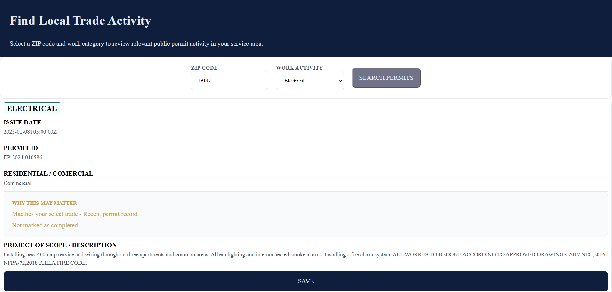

# Philly Trade Activity Finder

A lightweight front-end application that helps Philadelphia trade professionals explore recent public permit activity by ZIP code and work category.

Users can select a Philadelphia ZIP code and a category—such as Plumbing, Electrical, Mechanical, Building, Renovation, or Zoning view relevant public permit records in a clear, easy-to-scan interface. Each result summarizes the permit’s issue date, administrative status, work description, and permit ID so users can decide which records are worth researching further through official City resources.

> This project is designed as a public construction-activity research tool. It does not identify guaranteed leads, active bidding opportunities, real-time job-site activity, or property-owner contact information.

## How It's Made

**Tech used:** HTML, CSS, JavaScript, Philadelphia Carto API

Philly Trade Activity Finder was built as a responsive, mobile-first front-end project using semantic HTML, custom CSS, and vanilla JavaScript.

The application retrieves public permit data from the City of Philadelphia’s Licenses & Inspections dataset through the Philadelphia Carto API. Rather than displaying the raw API response directly, I created a data-normalization layer that converts permit records into a consistent format for the interface.

The main user flow is intentionally simple:

1. Enter a five-digit Philadelphia ZIP code.
2. Select a work category.
3. Submit the search form.
4. View recent public permit activity that matches the selected location and category.
5. Save a permit for later research or copy its permit ID for verification through official City records.

## Features

- Search completed Philadelphia permit records by ZIP code.
- Filter results by work category.
- Display permit records returned by a public API.
- Display permit issue date, status, work description, and permit ID.
- Convert technical work descriptions into readable work-category tags.
- Save permit records for later.
- Display loading, error, empty, and success states.

## Project Goal

The goal of this project is to transform complex public permit data into an easy-to-use research tool for Philadelphia trade professionals.

## API and Data Source

This project uses public permit data from the City of Philadelphia’s Licenses & Inspections dataset through the Philadelphia Carto API.

The API provides public permit records that may include fields such as permit number, ZIP code, permit type, issue date, administrative status, and a public description of the approved work.

Philadelphia Carto API Explorer:  
[https://cityofphiladelphia.github.io/carto-api-explorer/#permits](https://cityofphiladelphia.github.io/carto-api-explorer/#permits)

## Future Improvements

- Add a date-range selector for completed permits.
- Add a neighborhood-level filter without exposing exact residential addresses.

## Lessons Learned

Building this project helped me understand that public data needs thoughtful interpretation before it becomes useful in a user interface.

I learned how to work with an external API, filter public records, normalize inconsistent data, and display dynamic results in a way that supports a focused task.

## How I feel about my code

I completed the challenge: 5
I feel good about my code: 4
I feel that there is more to do for this project and I would like to go back and add the improvements.

**live demo**

https://clauya.github.io/simple-api-construction/